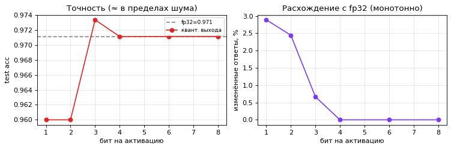
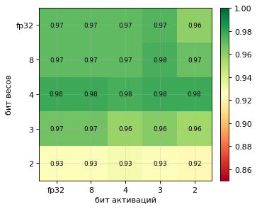
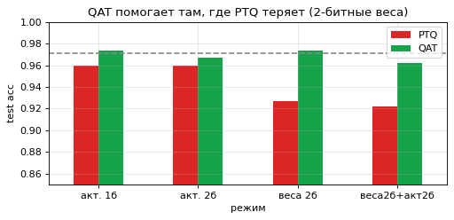
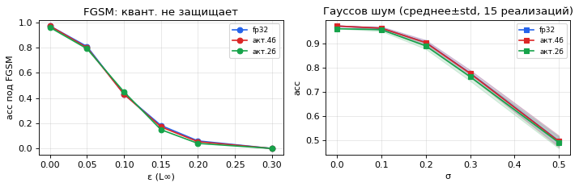
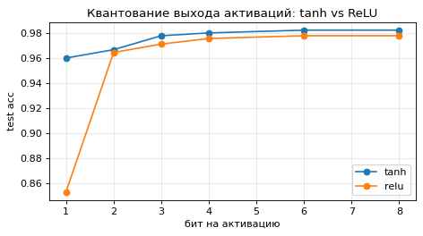
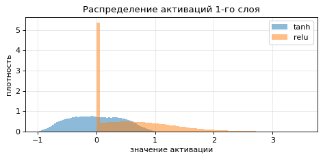

# P14. Квантованные функции активации

**Вопрос:** что произойдёт, если квантовать не только веса нейросети, но и *значения функций активации*?
Как это влияет на точность, ошибку приближения, скорость и устойчивость модели?

Командный учебный проект (2 человека), 2026

📓 [Код — Jupyter-ноутбук](P14_quantized_activations.ipynb) · 📄 [Отчёт — PDF](report.pdf)

## Что сделано

1. Равномерное квантование выходов активации на $2^b$ уровней.
2. Табличная (LUT) и кусочно-линейная (PWL) аппроксимации `tanh` по узлам.
3. Полносвязная сеть **64 → 128 → 64 → 10** (`tanh`, float32), написанная с нуля на NumPy
   (прямой/обратный проход, Adam, STE для градиента через квантователь).
4. Сравнение квантования весов и активаций одним и тем же квантователем.
5. Честное сравнение PTQ и QAT: одинаковая инициализация и одинаковые 60 эпох.
6. Устойчивость к гауссову шуму и FGSM-атаке, проверка маскировки градиента у LUT.
7. Оценка памяти и времени инференса.

**Данные:** `digits` из scikit-learn (8×8, 64 признака), 1347 train / 450 test, стратифицированное
разбиение, `SEED=42`. Точность базовой модели в float32 — **0.9711**.

## Результаты

### Ошибка аппроксимации `tanh` (сетка $z \in [-5, 5]$, узлы на $[-4, 4]$)

| Узлы | LUT MSE | LUT $E_{max}$ | PWL MSE |
|---:|---:|---:|---:|
| 3 | 2.07e-1 | 0.964 | 1.08e-1 |
| 9 | 1.11e-2 | 0.460 | 8.85e-4 |
| 17 | 2.77e-3 | 0.243 | 5.39e-5 |
| 65 | 1.73e-4 | 0.062 | 2.51e-7 |

PWL на порядки точнее ступенчатой LUT при том же числе узлов. На уровне модели:
3 узла LUT — 0.100, PWL с 2 отрезками — 0.962.

### PTQ выходов активации

| Бит | Точность | Изменённые ответы, % | MSE логитов |
|---:|---:|---:|---:|
| 1 | 0.960 | 2.89 | 1.9175 |
| 2 | 0.960 | 2.44 | 0.6058 |
| 3 | 0.973 | 0.67 | 0.1106 |
| 4 | 0.971 | 0.00 | 0.0250 |
| 8 | 0.971 | 0.00 | 0.0001 |



### Веса × активации

При одинаковом 4-уровневом квантователе: 2-битные активации — **0.960**, 2-битные веса — **0.927**,
оба — **0.922**. Веса чувствительнее активаций.



### PTQ vs QAT

| Режим | PTQ | QAT | Δ |
|---|---:|---:|---:|
| Активации, 1 бит | 0.960 | 0.964 | +0.004 |
| Активации, 2 бита | 0.960 | 0.967 | +0.007 |
| Веса, 2 бита | 0.927 | 0.980 | **+0.053** |
| Веса + активации, 2 бита | 0.922 | 0.969 | **+0.047** |



### Устойчивость

- FGSM при ε = 0.1: fp32 / 4 бита / 2 бита — 0.431 / 0.431 / 0.449; при ε = 0.2 — 0.060 / 0.053 / 0.040.
  Квантование активаций **не защищает** от атаки.
- **Маскировка градиента:** у кусочно-постоянной LUT истинный наклон ≈ 0, поэтому наивная атака
  оставляет точность ≈ 0.973 даже при ε = 0.2. STE-атака при том же ε снижает её до **0.062** —
  устойчивость была ложной.



### Дополнительно: `tanh` vs ReLU

Ограниченная `tanh` переносит грубое квантование выхода лучше, чем ReLU с калиброванным
диапазоном (99.9-й перцентиль): при 1 бите 0.960 против 0.853.

<p>
  
  
</p>

## Выводы

1. Активации `tanh` можно квантовать до 1–2 бит с потерей около 1 п.п. точности.
2. PWL значительно точнее LUT при одинаковом числе узлов.
3. Веса чувствительнее активаций при одинаковой битности.
4. QAT почти не нужен для квантования активаций, но восстанавливает точность при 2-битных весах.
5. Квантование активаций не защищает от FGSM; «устойчивость» LUT — маскировка градиента.
6. Экономия памяти линейна по битности, но в NumPy ускорения нет — нужно целочисленное железо.

**Ограничения:** маленький датасет 8×8, одна архитектура, одно зерно; из атак только FGSM
(PGD дал бы более строгую оценку); скорость измерена в NumPy.

## Запуск

```bash
pip install -r requirements.txt
jupyter notebook P14_quantized_activations.ipynb
```

Датасет загружается из scikit-learn офлайн, GPU не нужен. Ноутбук также запускается в Google Colab.

## Литература

1. Hubara et al. *Quantized Neural Networks: Training Neural Networks with Low Precision Weights and Activations.* arXiv:1609.07061, 2016.
2. Jacob et al. *Quantization and Training of Neural Networks for Efficient Integer-Arithmetic-Only Inference.* CVPR, 2018.
3. Goodfellow, Shlens, Szegedy. *Explaining and Harnessing Adversarial Examples.* ICLR, 2015.
