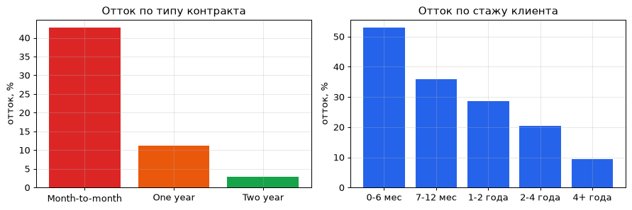
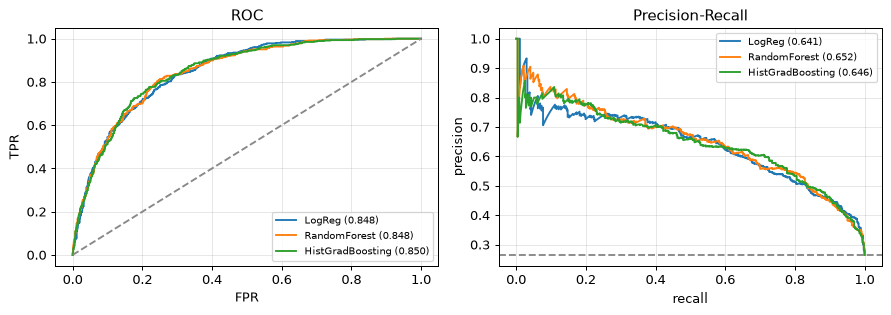
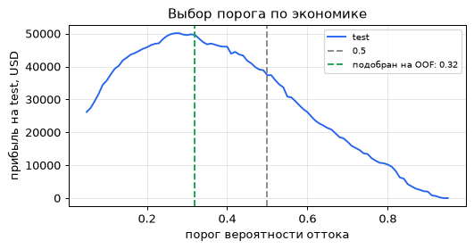

# Прогноз оттока клиентов: SQL-аналитика + ML

**Задача:** по данным телеком-оператора найти клиентов, которые скорее всего уйдут, и решить,
кому выгодно предложить удерживающую скидку.

📓 [Ноутбук](churn_sql_ml.ipynb) · 🗄️ [SQL-запросы](sql/)

## Пайплайн

```
сырые данные (7043 клиента) → таблица в БД (sql/schema.sql)
    → SQL-аналитика: отток по сегментам, когорты, оконные функции
    → SQL-витрина признаков (sql/features.sql)
    → модели scikit-learn (5-fold CV)
    → выбор порога по экономике удержания
```

**Данные:** [Telco Customer Churn](https://www.openml.org/d/42178) (OpenML), 26.5% оттока.
**БД:** SQLite из стандартной библиотеки Python. Запросы написаны на стандартном SQL (CTE, `CASE`,
оконные функции `SUM() OVER`, `RANK()`) и рассчитаны на PostgreSQL без изменений.

| Файл | Что делает |
|---|---|
| [`schema.sql`](sql/schema.sql) | схема таблицы `customers` |
| [`churn_by_contract.sql`](sql/churn_by_contract.sql) | отток и потерянная выручка по типу контракта, доля через оконную функцию |
| [`churn_by_tenure.sql`](sql/churn_by_tenure.sql) | когорты по стажу клиента, накопленная доля ушедших |
| [`top_segments.sql`](sql/top_segments.sql) | топ-5 рискованных сегментов через `RANK()` |
| [`features.sql`](sql/features.sql) | представление `customer_features` — витрина признаков для модели |

## Результаты

### SQL-аналитика

| Контракт | Клиентов | Отток | Доля потерянной выручки |
|---|---:|---:|---:|
| Month-to-month | 3875 | **42.7%** | 86.9% |
| One year | 1473 | 11.3% | 10.1% |
| Two year | 1695 | 2.8% | 3.0% |

- 42% всех ушедших — клиенты в первые 6 месяцев (отток в этой когорте 52.9%).
- Самый рискованный сегмент: помесячный контракт + оптоволокно + электронный чек — **60.4%** оттока.



### Модели (5-fold CV на train, отдельный test 25%)

| Модель | CV ROC-AUC | CV PR-AUC | test ROC-AUC | test PR-AUC |
|---|---:|---:|---:|---:|
| LogReg | 0.843 ± 0.015 | 0.662 ± 0.039 | 0.848 | 0.641 |
| RandomForest | 0.845 ± 0.013 | 0.668 ± 0.032 | 0.848 | 0.652 |
| HistGradBoosting | 0.843 ± 0.013 | 0.665 ± 0.033 | 0.850 | 0.646 |

Модели почти равны: зависимости в табличных данных простые, поэтому интерпретируемая
логистическая регрессия — разумный выбор для продакшена.



### Порог по экономике удержания

Допущения: скидка стоит 1 месячный платёж, удерживает 30% уходящих, удержанный клиент приносит
ещё 12 месяцев выручки. Порог подбирается на **out-of-fold** предсказаниях train, test используется
только для итоговой оценки.

| Порог | Предложений | Найдено уходящих | Прибыль на test |
|---|---:|---:|---:|
| 0.50 (по умолчанию) | 330 | 48% | 37.4 тыс. USD |
| 0.28 (теоретический p\* = cost / (success · horizon)) | 699 | 81% | 50.3 тыс. USD |
| **0.32 (подобран на OOF)** | 637 | 76% | **49.6 тыс. USD (+33%)** |



Главные признаки (permutation importance): тип контракта, стаж, тип интернета, сумма платежей.

## Ограничения

Одна выборка без временной компоненты; экономика удержания задана допущениями, а не A/B-тестом;
эффект скидки в реальности нужно измерять.

## Запуск

```bash
pip install -r requirements.txt
jupyter notebook churn_sql_ml.ipynb
```

Датасет скачивается с OpenML при первом запуске (кешируется в `data/`).
