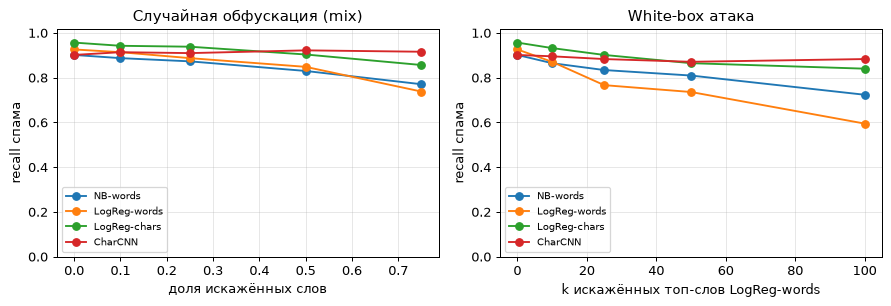
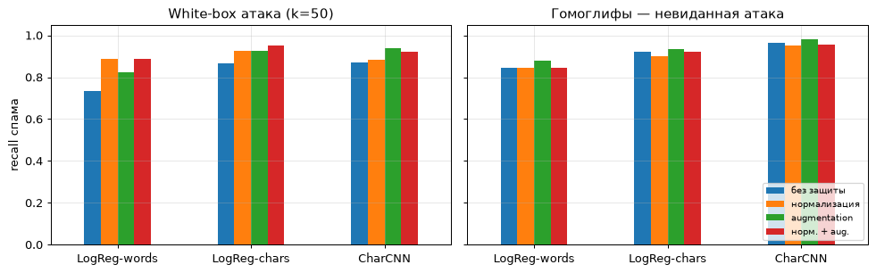

# Детектор SMS-спама и его устойчивость к обфускации

**Вопрос:** насколько легко обойти спам-фильтр, если спамер слегка искажает текст
(`free` → `fr33`, `f.r.e.e`)? Какие модели устойчивее и какие защиты работают?

📓 [Ноутбук](spam_robustness.ipynb)

## Что сделано

1. **Модели:** TF-IDF по словам + Naive Bayes / логистическая регрессия, TF-IDF по символьным n-граммам +
   логистическая регрессия и свёрточная сеть по символам **CharCNN** на PyTorch.
2. **Атаки** (меняется только спам, смысл для человека сохраняется):
   - *случайная* — каждое слово искажается с вероятностью `rate` (leetspeak `e→3, o→0, a→@` или разбивка `f.r.e.e`);
   - *white-box* — спамер знает модель и искажает её топ-k самых «спамных» слов;
   - *гомоглифы* — латинские буквы заменяются похожими кириллическими: на экране текст не меняется.
3. **Защиты:** нормализация текста перед моделью и обучение на искажённых примерах (adversarial augmentation).
   Гомоглифы не используются ни в одной защите — это проверка на атаку, которой модель не видела.

**Данные:** [SMS Spam Collection](https://archive.ics.uci.edu/dataset/228/sms+spam+collection) (UCI, CC BY 4.0),
5171 уникальное сообщение, 12.6% спама; стратифицированное разбиение 75/25, `SEED=42`.

## Результаты

### Чистые данные

| Модель | Precision | Recall | F1 | PR-AUC | Обучение |
|---|---:|---:|---:|---:|---:|
| NB-words | 0.980 | 0.902 | 0.939 | 0.977 | 0.1 с |
| LogReg-words | 0.950 | 0.926 | 0.938 | 0.976 | 0.2 с |
| **LogReg-chars** | 0.981 | **0.957** | **0.969** | **0.990** | 0.9 с |
| CharCNN (PyTorch) | **0.993** | 0.902 | 0.945 | 0.976 | ~19 с |

### Атаки



White-box атака на 50 самых «спамных» слов снижает recall LogReg-words с **0.926 до 0.736**:
каждое четвёртое спам-сообщение проходит фильтр. Модели по символам теряют меньше (0.865–0.871).

### Защиты

| Модель | Защита | F1 (чистый) | Recall: случайная 0.5 | Recall: white-box k=50 | Recall: гомоглифы |
|---|---|---:|---:|---:|---:|
| LogReg-words | без защиты | 0.938 | 0.840 | 0.736 | 0.847 |
| LogReg-words | нормализация | 0.935 | 0.896 | **0.890** | 0.847 |
| LogReg-chars | без защиты | 0.969 | 0.902 | 0.865 | 0.920 |
| LogReg-chars | augmentation | 0.959 | **0.988** | 0.926 | 0.933 |
| LogReg-chars | норм. + aug. | 0.962 | 0.963 | **0.951** | 0.920 |
| CharCNN | без защиты | 0.945 | 0.902 | 0.871 | 0.963 |
| CharCNN | augmentation | 0.956 | 0.994 | 0.939 | **0.982** |

Полная таблица — в ноутбуке.



## Выводы

- Лучшая модель на чистых данных — простая и быстрая: TF-IDF по символам + логистическая регрессия.
- Словесные модели легко обойти обфускацией, символьные заметно устойчивее.
- Нормализация — дешёвая защита без потери качества; аугментация сильнее всего помогает символьным моделям.
- **Защиты не обобщаются:** на гомоглифах нормализация не помогает, аугментация даёт лишь +0.01–0.03.
  Устойчивость нужно проверять на атаках, которых модель не видела.

**Ограничения:** небольшой англоязычный датасет; атаки синтетические; white-box атака построена
против одной модели; в таблице защит результат случайной атаки — по одной реализации.

## Запуск

```bash
pip install -r requirements.txt
jupyter notebook spam_robustness.ipynb
```

Датасет скачивается с UCI при первом запуске (сохраняется в `data/`). GPU не нужен, весь ноутбук
выполняется на CPU примерно за 2 минуты.
